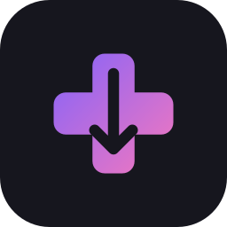

<div align="center">
  <a href="https://github.com/arunoruto/rommate">
    
  </a>

<h3 align="center">rommate for Decky</h3>

  <p align="center">
    Browse your <a href="https://romm.app">RomM</a> server and download games straight into the folders ES-DE,
    EmuDeck and RetroDECK expect, without leaving Game Mode.
    <br />
    <a href="https://arunoruto.github.io/rommate/"><strong>rommate documentation »</strong></a>
  </p>
</div>

## About

A [Decky Loader](https://decky.xyz) plugin for [rommate](https://github.com/arunoruto/rommate). It adds a
Quick Access panel where you can:

- see every platform on your RomM server and how many of its games are on the device,
- download single games or everything you're missing, with a Steam-style progress bar,
- cancel downloads (they resume next time) and retry failed ones,
- sync emulator saves with RomM: automatically whenever a game closes, or with a button, and settle conflicts by
  choosing which save to keep,
- connect to your server with the on-screen keyboard,
- open the full rommate TUI as a Steam shortcut with its own artwork (capsule, wide capsule, hero, logo and icon);
  the controller works with Steam's default layout.

The plugin is **universal**: it bundles rommate for both x86-64 (Steam Deck, Steam Machine) and ARM64 (handhelds
running [Armada](https://armadaos.dev)) and picks the right one at runtime. It shares its configuration with the
rommate CLI and TUI (`~/.config/rommate/config.toml`), so setting it up in one place sets it up everywhere.

## Install

Until the plugin is in the Decky store:

1. In Decky's settings, enable **Developer mode**.
2. Under **Developer**, choose **Install plugin from URL** and paste the link to `rommate.zip` from the
   [latest release](https://github.com/arunoruto/decky-rommate/releases/latest).

## How it works

```text
Quick Access panel (React, @decky/ui)  ⇄  main.py (Decky backend)  →  rommate … --json
```

The frontend calls the Python backend, which runs the bundled `rommate` binary with `--json` and turns its progress
events into Decky events. To sync saves when a game closes, the frontend listens to Steam's game lifetime
notifications and asks the backend to run `rommate saves sync`. All the real work (folder mapping, resumable downloads, download state) happens in
rommate itself. The binaries come from a pinned [rommate release](https://github.com/arunoruto/rommate/releases)
via `remote_binary` in `package.json`, with SHA-256 checksums.

## Development

The dev shell comes from [github:arunoruto/flake](https://github.com/arunoruto/flake) (`#node-lsp`: Node.js, pnpm,
just and TypeScript language servers). With [nix-direnv](https://github.com/nix-community/nix-direnv) it loads via
`.envrc`; otherwise run `nix develop github:arunoruto/flake#node-lsp`.

```sh
just build    # frontend → dist/index.js
just check    # type-check the frontend, lint the backend
just zip      # installable plugin → out/decky-rommate.zip (Decky CLI, needs Docker)
just deploy   # build, copy to armada@armada.local and restart Decky (or: just deploy user@host)
```

To use a newer rommate, update the two `remote_binary` URLs and `sha256hash` values in `package.json` from that
release's `checksums.txt`.

## License

MIT, see [`LICENSE`](LICENSE).
